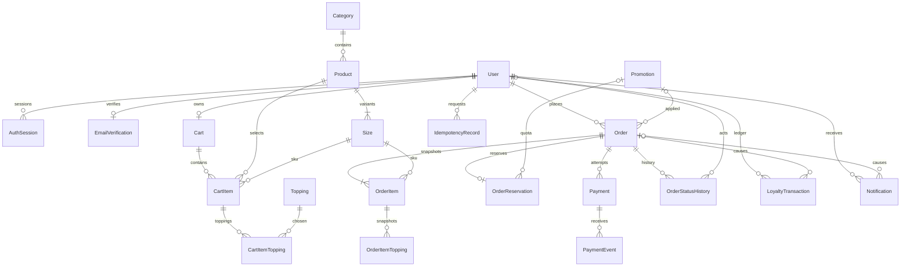

# Database design baseline — Size là SKU

> Cập nhật P2 07/11/2026: xem [báo cáo implementation](p2-implementation-report.md) cho schema, migration đã áp dụng và bằng chứng test hiện tại. Các bảng bên dưới ghi thiết kế baseline gốc.

Mục tiêu P2/P3/P5/P6; chưa áp dụng vào Prisma. Tham chiếu [ADR](adr/0001-p0-baseline.md), [migration](migration-plan.md).

## As-Is và To-Be

Giữ nguyên 16 model: User, EmailVerification, AuthSession, Category, Product, Size, Topping, Cart, CartItem, Order, OrderItem, OrderItemTopping, Payment, Promotion, LoyaltyTransaction, Notification. ID hiện là UUID dạng chuỗi do Prisma sinh, PostgreSQL TEXT; chưa yêu cầu đổi native UUID. API validate UUID. Tiền hiện Decimal(10,2), không đổi toàn bộ kiểu cột ở P0/P2.

| Model | Diff mục tiêu, không phải migration đã thực hiện |
| --- | --- |
| User | Thêm reservedPoints Int default 0; role mục tiêu ba giá trị; email canonical lowercase/trim, kiểm tra collision trước unique chuẩn hóa. |
| AuthSession | Mỗi rotation một row: familyId, parentId nullable unique self-FK, refreshTokenHash nullable unique, refreshUsedAt nullable; expiresAt là hạn family tuyệt đối, revokedAt; index familyId/expiresAt. Row cũ không có refresh không được tự cấp token. |
| EmailVerification | Giữ codeHash/expiresAt/attempts/sentAt; service TTL 5 phút. Xóa khi consume thành công đã chống replay, không cần consumedAt nếu không cần audit OTP. |
| Size | Thêm onHand Int? (NULL=chưa phân bổ), reserved Int default 0, isAvailable Boolean, version Int default 0 cho chỉnh inventory; sau kiểm tra chặt productId bắt buộc, unique(productId,name), unique(productId,id) nếu composite FK. |
| Product | stockQuantity legacy; không tiếp tục ghi nguồn tồn sau switch. isAvailable kiểm soát bán/ẩn toàn Product. |
| Cart | version Int default 0, mỗi mutation tăng version một lần; userId unique cho giỏ đã login. sessionId legacy không được dùng để truy cập giỏ người khác. |
| CartItem | sizeId nullable ở expand, configurationKey nullable, requiresConfiguration default false; backfill true cho dòng không rõ cấu hình. New item bắt buộc sizeId và key. unique(cartId,configurationKey). |
| Order | expiresAt nullable cho legacy; version; promotionId nullable FK, couponCodeSnapshot và policyVersion; index(userId,createdAt), (status,createdAt). userId lịch sử nullable được giữ, new order bắt buộc actor từ JWT. |
| OrderItem | sizeId nullable legacy FK Size; giữ productName/sizeName/unitPrice/quantity/lineTotal/note snapshot; thêm basePriceSnapshot và sizeExtraSnapshot nếu hiển thị tách giá. unitPrice đã gồm topping, không cộng topping lần hai. |
| OrderItemTopping | Giữ toppingName/price snapshot; toppingId nullable FK để truy vết, không dùng giá hiện tại sửa hóa đơn cũ. |
| Payment | Thêm UNKNOWN; attemptNumber nullable cho legacy rồi backfill có kiểm chứng; unique(orderId,attemptNumber); providerPaymentId unique nullable, resolvedAt/reconciliation marker; idempotency cũ giữ tương thích, không đủ thay IdempotencyRecord. |
| Promotion | reservedCount default 0; perUserLimit nullable nếu cấu hình; usedCount chỉ tăng sau SUCCESS. Không sửa coupon snapshot của đơn cũ. |
| LoyaltyTransaction | orderId nullable cho legacy FK Order; unique(orderId,type) cho EARN/REDEEM một lần/đơn; giữ balanceAfter. role hiện có là legacy metadata, không dùng làm nguồn phân quyền. |
| Notification | orderId nullable FK, eventKey nullable unique; trạng thái đơn mới phát event riêng, retry cùng event không tạo bản ghi khác. |

## Năm bảng mới

| Model | Fields tối thiểu / quan hệ |
| --- | --- |
| CartItemTopping | cartItemId FK cascade CartItem; toppingId FK restrict Topping; composite PK(cartItemId,toppingId). |
| OrderReservation | id; orderId unique FK; promotionId nullable FK (phải khớp coupon Order); pointsReserved; state HELD/CONSUMED/RELEASED; expiresAt, consumedAt, releasedAt. Lượng hàng = tổng quantity các OrderItem theo sizeId của Order; các dòng này bất biến sau tạo. |
| OrderStatusHistory | id; orderId FK; fromStatus nullable cho tạo đơn; toStatus; actorId nullable FK User; actorType USER/SYSTEM; createdAt; orderVersion; unique(orderId,orderVersion). |
| IdempotencyRecord | id; actorId FK User; operation; key; requestHash; state IN_PROGRESS/SUCCEEDED; resourceId/result JSON an toàn; responseStatus; createdAt/expiresAt; unique(actorId,operation,key). Không lưu cookie/token/mật khẩu. |
| PaymentEvent | id; paymentId FK; providerEventId unique; providerPaymentId; verified amount/order reference; outcome; receivedAt/processedAt; processing status/reconciliation reason. Không lưu PAN/CVV, không coi body client là sự kiện tin cậy. |

21 bảng là mục tiêu, không tính _prisma_migrations. Không tạo RefreshToken, ProductSKU, dashboard hoặc bảng kho nguyên liệu riêng trong baseline này.

## Constraints và tính nhất quán

- Size: onHand NULL thì reserved=0 và không thể đặt; nếu onHand có giá trị: 0<=reserved<=onHand. availability tính từ onHand-reserved và cờ Product/Size.
- CartItem quantity nguyên 1..20. Topping không lặp trong một dòng. Size phải thuộc đúng productId (composite FK tới Size(productId,id), hoặc ràng buộc tương đương được kiểm chứng).
- configurationKey = SHA-256 của canonical JSON [productId,sizeId,sorted unique toppingIds,normalizedNote]. Note chỉ trim hai đầu và chuẩn hóa CRLF→LF; giữ nội dung, dấu và hoa/thường, không normalize mật khẩu theo quy tắc này. Quantity/giá không nằm trong key.
- User reservedPoints>=0 và <=loyaltyPoints. Promotion reservedCount>=0, usedCount>=0, usedCount+reservedCount<=usageLimit.
- Money nonnegative và bằng floor(value); dùng Prisma.Decimal/decimal arithmetic, không chuyển Number để cộng tiền. JSON là chuỗi nguyên, không exponent/dấu phẩy/phần thập phân.
- Mọi lần tạo/đổi Order có history/version; chỉ transition thành công mới ghi side effect.
- Foreign key tài nguyên lịch sử tránh cascade xóa khi ADMIN ẩn catalog. New catalog dùng disable/soft-hide, không xóa sản phẩm/size đã có order.
- Legacy NULL được giữ trong expand; không tạo key/size/snapshot giả để ép NOT NULL.

## ERD mục tiêu

ERD là thiết kế P0 mới trong Markdown; không tuyên bố đã sửa ClassDiagram.png hoặc nguồn Visual Paradigm. Optional relation cho legacy không có nghĩa new order được phép thiếu user/SKU/reservation.